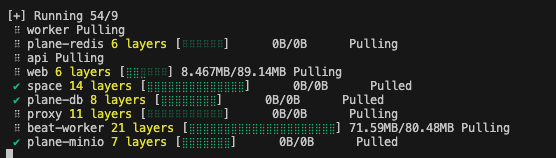
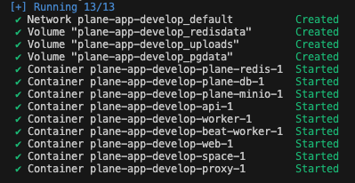
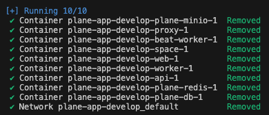
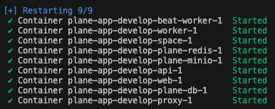
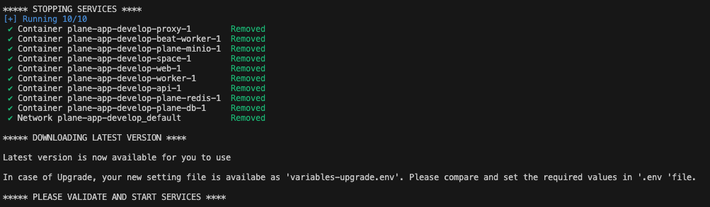
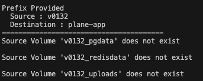

# 私有化部署

本指南带你完成 Strata 的自托管（self-host）部署。自托管让你完全掌控应用与数据，是保证隐私、控制力与可定制性的最佳方式。

这里覆盖两种部署方式：云服务器和本地桌面。云服务器以 AWS EC2 为例，本地桌面用 Docker 搭建本地环境。

开始吧！

## 准备 Docker 环境

<details>
  <summary>方式一：使用云服务器</summary>
  <p>最省事的起点是在 AWS 上创建一台 EC2 实例，最低配置 2 vCPU / 4GB 内存。</p>
  <p>执行下面的命令安装 Docker Engine。</p>

`curl -fsSL https://get.docker.com | sh -`

</details>

---

<details>
  <summary>方式二：使用本地桌面</summary>

#### macOS

  <ol>
    <li> 从 <a href="https://hub.docker.com/editions/community/docker-ce-desktop-mac/" target="_blank">Docker Hub</a> 下载 Docker Desktop for Mac。 </li>
    <li> 双击下载的 <code>.dmg</code> 文件，把 Docker 图标拖到 Applications 文件夹。 </li>
    <li>从 Applications 打开 Docker Desktop。安装附加组件时可能会要求输入系统密码。</li>
  </ol>

#### Windows

  <ol>
    <li>从 <a href="https://hub.docker.com/editions/community/docker-ce-desktop-windows/" target="_blank">Docker Hub</a> 下载 Docker Desktop for Windows。</li>
    <li>运行安装程序并按其提示操作，过程中可能会要求启用 Hyper-V 与「容器」Windows 功能。</li>
    <li>打开 Docker Desktop。为使改动生效，可能会要求你注销后重新登录，或重启机器。</li>
  </ol>

安装完成后，打开终端（Windows 用命令提示符，macOS 用 Terminal）执行 `docker --version` 验证，能打印出版本号即可。

</details>

---

## 安装 Strata

安装 Strata 的步骤很少。

### 前置条件

- Docker 已安装并运行
- 支持 bash 脚本的系统（Ubuntu、Linux AMI、macOS）。Windows 需要安装 [gitbash](https://git-scm.com/download/win)
- 执行安装的用户要有 Docker 权限；多数情况下用 `sudo su` 切到 root
- 后续所有步骤都在终端（或 gitbash）中执行

### 下载最新版本

```
mkdir strata-selfhost

cd strata-selfhost
```

#### 使用 _Docker Compose_

```
curl -fsSL -o setup.sh https://github.com/makestrata/strata/releases/latest/download/setup.sh

chmod +x setup.sh
```

#### 使用 _Docker Swarm_

```
curl -fsSL -o setup.sh https://github.com/makestrata/strata/releases/latest/download/swarm.sh

chmod +x setup.sh
```

---

### 执行安装

上面的步骤完成后，就可以安装并启动 Strata 服务了。

执行 `./setup.sh`，会弹出如下选项。

#### Docker Compose

```bash
Select an Action you want to perform:
   1) Install (x86_64)
   2) Start
   3) Stop
   4) Restart
   5) Upgrade
   6) View Logs
   7) Backup Data
   8) Exit

Action [2]: 1
```

首次安装输入 `1`。

这一步会创建 `strata-app` 目录，并在其中下载两个文件：

- `docker-compose.yaml`
- `strata.env`

随后会再次弹出 `options [1-8]`，此时输入 `8` 退出。

#### Docker Swarm

```bash
Select an Action you want to perform:
   1) Deploy Stack
   2) Remove Stack
   3) View Stack Status
   4) Redeploy Stack
   5) Upgrade
   6) View Logs
   7) Exit

Action [3]: 1
```

首次部署输入 `1`。

这一步会创建 `strata-app` 目录，并在其中下载两个文件：

- `docker-compose.yaml`
- `strata.env`

随后会再次弹出 `options [1-7]`，此时输入 `7` 退出。

---

### 继续配置 - 环境变量

继续之前，建议先检查 `.env` 文件并设置其中的值。以下是最关键的几个键。_<span style="color: #fcba03">可以用任意文本编辑器编辑该文件</span>_。

> `LISTEN_HTTP_PORT` —— 默认 `80`。请确保所选端口未被占用（例如 `LISTEN_HTTP_PORT=8080`）。

> `WEB_URL` —— 默认 `http://localhost`。改成你计划使用的完整域名，并带上 `LISTEN_HTTP_PORT`（例如 `https://strata.example.com:8080` 或 `http://[IP-ADDRESS]:8080`）。

> `CORS_ALLOWED_ORIGINS` —— 默认 `http://localhost`。同样改成计划使用的完整域名并带上端口（例如 `https://strata.example.com:8080` 或 `http://[IP-ADDRESS]:8080`）。

还有其他配置项可以调整，但建议至少把「邮件设置」配好，这样才能邀请队友加入。

#### 代理后的客户端 IP 与限流

部分端点按客户端 IP 限流，`strata.env` 里有两个设置决定该 IP 如何获取：

- **Strata 直接暴露在公网、位于内置代理之后**：设置 `TRUSTED_PROXIES=private_ranges`（或你的负载均衡网段）与 `NUM_PROXIES=1`。
- **前面还有一层负载均衡或 CDN**：把它的网段加入 `TRUSTED_PROXIES`（空格分隔，例如 `TRUSTED_PROXIES=private_ranges 203.0.113.0/24`），每多一跳就把 `NUM_PROXIES` 加一（例如 `NUM_PROXIES=2`）。
- **`NUM_PROXIES` 留空、`TRUSTED_PROXIES` 保持默认（`0.0.0.0/0`）** 则沿用现有行为。

修改后请重启服务。

---

### 继续配置 - 启动服务（Docker Compose）

再次执行 `./setup.sh`，会再次弹出选项。这次输入 `2` 启动服务。

```bash
Select a Action you want to perform:
   1) Install (x86_64)
   2) Start
   3) Stop
   4) Restart
   5) Upgrade
   6) View Logs
   7) Backup Data
   8) Exit

Action [2]: 2
```

输出类似下面这样。


下载速度与机器配置不同，可能需要等一会儿。一切顺利的话，你会看到：



这表示所有镜像已下载完成、服务已启动。

至此 Strata 实例已自托管成功。用你配置的 IP 或域名访问即可（例如 `https://strata.example.com:8080` 或 `http://[IP-ADDRESS]:8080`）。

---

### 停止服务 / 移除 Stack

如果要修改 `strata.env`，建议先停止服务。

#### Docker Compose

再次执行 `./setup.sh`，这次输入 `3` 停止服务。

```bash
Select a Action you want to perform:
   1) Install (x86_64)
   2) Start
   3) Stop
   4) Restart
   5) Upgrade
   6) View Logs
   7) Backup Data
   8) Exit

Action [2]: 3
```

一切顺利的话会看到：



#### Docker Swarm

再次执行 `./setup.sh`，这次输入 `2` 移除 Stack。

```bash
   1) Deploy Stack
   2) Remove Stack
   3) View Stack Status
   4) Redeploy Stack
   5) Upgrade
   6) View Logs
   7) Exit

Action [3]: 2
```

一切顺利的话，Docker CLI 会给出确认。

---

### 重启服务 / 重新部署

如果只想改 `strata.env` 而不停服务，或者发现服务异常，可以用 `RESTART` / `REDEPLOY` 重启。

再次执行 `./setup.sh`，这次输入 `4` 重启。

#### Docker Compose

```bash
Select a Action you want to perform:
   1) Install (x86_64)
   2) Start
   3) Stop
   4) Restart
   5) Upgrade
   6) View Logs
   7) Backup Data
   8) Exit

Action [2]: 4
```

一切顺利的话会看到：



#### Docker Swarm

```bash
   1) Deploy Stack
   2) Remove Stack
   3) View Stack Status
   4) Redeploy Stack
   5) Upgrade
   6) View Logs
   7) Exit

Action [3]: 4
```

一切顺利的话，Docker CLI 会给出确认。

---

### 升级 Strata 版本

建议始终保持在最新版本。

> 升级前请先下载最新的 `setup.sh`（见[下载最新版本](#下载最新版本)）。升级运行的是你本地的脚本，新版本脚本会生成或轮换 `strata.env` 中的对象存储（MinIO）凭据。

再次执行 `./setup.sh`，这次输入 `5` 升级。

#### Docker Compose

```bash
Select a Action you want to perform:
   1) Install (x86_64)
   2) Start
   3) Stop
   4) Restart
   5) Upgrade
   6) View Logs
   7) Backup Data
   8) Exit

Action [2]: 5
```

该操作会先停止服务，再下载最新的 `docker-compose.yaml` 与 `strata.env`。

会看到如下提示：



完成后输入 `8` 退出。

> 请务必检查 `strata.env`，确认新增或变更的配置。

改完 `strata.env` 后，回到「启动服务」步骤。

#### Docker Swarm

再次执行 `./setup.sh`，这次输入 `5` 升级。

```bash
   1) Deploy Stack
   2) Remove Stack
   3) View Stack Status
   4) Redeploy Stack
   5) Upgrade
   6) View Logs
   7) Exit

Action [3]: 5
```

该操作会先停止服务，再下载最新的 `docker-compose.yaml` 与 `strata.env`。

完成后输入 `7` 退出。

> 请务必检查 `strata.env`，确认新增或变更的配置。

改完 `strata.env` 后，回到「重新部署 Stack」步骤。

---

### 查看日志

有时需要确认 API、Worker 或其他容器内部发生了什么。

再次执行 `./setup.sh`，这次输入 `6` 查看日志。

#### Docker Compose

```bash
Select a Action you want to perform:
   1) Install (x86_64)
   2) Start
   3) Stop
   4) Restart
   5) Upgrade
   6) View Logs
   7) Backup Data
   8) Exit

Action [2]: 6
```

#### Docker Swarm

```bash
   1) Deploy Stack
   2) Remove Stack
   3) View Stack Status
   4) Redeploy Stack
   5) Upgrade
   6) View Logs
   7) Exit

Action [3]: 6
```

#### 日志的服务子菜单

接下来会列出服务列表：

```bash
Select a Service you want to view the logs for:
   1) Web
   2) Space
   3) API
   4) Worker
   5) Beat-Worker
   6) Migrator
   7) Proxy
   8) Redis
   9) Postgres
   10) Minio
   11) RabbitMQ
   0) Back to Main Menu

Service: 3
```

选择任意服务（例如 `3`），输出大致如下：

```bash
api-1  | Waiting for database...
api-1  | Database available!
api-1  | Waiting for database migrations to complete...
api-1  | Waiting for database migrations to complete...
api-1  | Waiting for database migrations to complete...
api-1  | Waiting for database migrations to complete...
api-1  | Waiting for database migrations to complete...
api-1  | Waiting for database migrations to complete...
api-1  | Waiting for database migrations to complete...
api-1  | No migrations Pending. Starting processes ...
api-1  | Instance registered
api-1  | ENABLE_SIGNUP loaded with value from environment variable.
api-1  | ENABLE_EMAIL_PASSWORD loaded with value from environment variable.
api-1  | ENABLE_MAGIC_LINK_LOGIN loaded with value from environment variable.
api-1  | GOOGLE_CLIENT_ID loaded with value from environment variable.
api-1  | GITHUB_CLIENT_ID loaded with value from environment variable.
api-1  | GITHUB_CLIENT_SECRET loaded with value from environment variable.
api-1  | EMAIL_HOST loaded with value from environment variable.
api-1  | EMAIL_HOST_USER loaded with value from environment variable.
api-1  | EMAIL_HOST_PASSWORD loaded with value from environment variable.
api-1  | EMAIL_PORT loaded with value from environment variable.
api-1  | EMAIL_FROM loaded with value from environment variable.
api-1  | EMAIL_USE_TLS loaded with value from environment variable.
api-1  | EMAIL_USE_SSL loaded with value from environment variable.
api-1  | OPENAI_API_KEY loaded with value from environment variable.
api-1  | GPT_ENGINE loaded with value from environment variable.
api-1  | UNSPLASH_ACCESS_KEY loaded with value from environment variable.
api-1  | Checking bucket...
api-1  | Bucket 'uploads' does not exist. Creating bucket...
api-1  | Bucket 'uploads' created successfully.
api-1  | Public read access policy set for bucket 'uploads'.
api-1  | Cache Cleared
api-1  | [2024-05-02 03:56:01 +0000] [1] [INFO] Starting gunicorn 21.2.0
api-1  | [2024-05-02 03:56:01 +0000] [1] [INFO] Listening at: http://0.0.0.0:8000 (1)
api-1  | [2024-05-02 03:56:01 +0000] [1] [INFO] Using worker: uvicorn.workers.UvicornWorker
api-1  | [2024-05-02 03:56:01 +0000] [25] [INFO] Booting worker with pid: 25
api-1  | [2024-05-02 03:56:03 +0000] [25] [INFO] Started server process [25]
api-1  | [2024-05-02 03:56:03 +0000] [25] [INFO] Waiting for application startup.
api-1  | [2024-05-02 03:56:03 +0000] [25] [INFO] ASGI 'lifespan' protocol appears unsupported.
api-1  | [2024-05-02 03:56:03 +0000] [25] [INFO] Application startup complete.

```

按 `CTRL+C` 退出日志，回到主菜单。其他服务的日志同理。

---

### 备份数据（Docker Compose）

有时需要把 Docker 卷里的数据备份到 S3 或本地磁盘。

再次执行 `./setup.sh`，这次输入 `7` 进行备份。

```bash
Select a Action you want to perform:
   1) Install (x86_64)
   2) Start
   3) Stop
   4) Restart
   5) Upgrade
   6) View Logs
   7) Backup Data
   8) Exit

Action [2]: 7
```

完成后会生成备份目录：

```bash
Backing Up strata-app_pgdata
Backing Up strata-app_redisdata
Backing Up strata-app_uploads

Backup completed successfully. Backup files are stored in /....../strata-app/backup/20240502-1120
```

---

### 恢复数据（Docker Compose）

需要恢复之前的备份时，按以下步骤操作。

1. 确认 Strata-CE 已完成安装、启动并停止。这样 Docker 卷才已创建。

2. 用下面的命令下载恢复脚本。建议与 `setup.sh` 放在同一目录。

   ```bash
   curl -fsSL -o restore.sh https://github.com/makestrata/strata/releases/latest/download/restore.sh
   chmod +x restore.sh
   ```

3. 执行恢复。

   ```bash
   ./restore.sh <path to backup folder containing *.tar.gz files>
   ```

   以备份目录 `/opt/strata-selfhost/strata-app/backup/20240722-0914` 为例，输出大致如下：

   ```bash
   --------------------------------------------
    ____  _                          /////////
   |  _ \| | __ _ _ __   ___         /////////
   | |_) | |/ _` | '_ \ / _ \   /////    /////
   |  __/| | (_| | | | |  __/   /////    /////
   |_|   |_|\__,_|_| |_|\___|        ////
                                     ////
   --------------------------------------------
   Project management tool from the future
   --------------------------------------------
   Found /opt/strata-selfhost/strata-app/backup/20240722-0914/pgdata.tar.gz
   .....Restoring strata-app_pgdata
   .....Successfully restored volume strata-app_pgdata from pgdata.tar.gz

   Found /opt/strata-selfhost/strata-app/backup/20240722-0914/redisdata.tar.gz
   .....Restoring strata-app_redisdata
   .....Successfully restored volume strata-app_redisdata from redisdata.tar.gz

   Found /opt/strata-selfhost/strata-app/backup/20240722-0914/uploads.tar.gz
   .....Restoring strata-app_uploads
   .....Successfully restored volume strata-app_uploads from uploads.tar.gz


   Restore completed successfully.
   ```

4. 用 `./setup.sh start` 启动 Strata 实例。

---

### 商业离线版数据恢复（Docker Compose）

在 Strata 商业离线版（Air-Gapped）上恢复备份时，按以下步骤操作。

1. 下载恢复脚本

   ```bash
   curl -fsSL -o restore-airgapped.sh https://github.com/makestrata/strata/releases/latest/download/restore-airgapped.sh
   chmod +x restore-airgapped.sh
   ```

2. 把备份目录与 `restore-airgapped.sh` 复制到商业离线版服务器。

3. 确认 Strata 商业（离线）版已解压并可用；如果正在运行，先停止。

4. 执行恢复

   ```bash
   ./restore-airgapped.sh <path to backup folder containing *.tar.gz files>
   ```

5. 恢复完成后，即可带着原有数据启动 Strata 商业（离线）版。

---

<details>
   <summary><h2>从 v0.13.2 升级到 v0.14.x</h2></summary>

这是从 v0.13.2 升到 v0.14.0 的用户需要执行的一次性操作。

由于自托管流程有较大变化，这一步主要把数据从旧（v0.13.2）的 Docker 卷迁移到新建的卷。

> 开始前请确保 v0.14.0 已启动过一次并已停止，这样才能拿到新建卷的名称。

先下载迁移脚本：

```

curl -fsSL -o migrate.sh https://raw.githubusercontent.com/makestrata/strata/master/deploy/selfhost/migration-0.13-0.14.sh

chmod +x migrate.sh

```

执行 `./migrate.sh`，会看到如下说明：

```
******************************************************************

This script is solely for the migration purpose only.
This is a 1 time migration of volume data from v0.13.2 => v0.14.x

Assumption:
1. Postgres data volume name ends with _pgdata
2. Minio data volume name ends with _uploads
3. Redis data volume name ends with _redisdata

Any changes to this script can break the migration.

Before you proceed, make sure you run the below command
to know the docker volumes

docker volume ls -q | grep -i "_pgdata"
docker volume ls -q | grep -i "_uploads"
docker volume ls -q | grep -i "_redisdata"

*******************************************************

Given below list of REDIS volumes, identify the prefix of source and destination volumes leaving "_redisdata"
---------------------
strata-app_redisdata
v0132_redisdata

Provide the Source Volume Prefix :
```

**另开一个终端窗口**，执行上面提到的 3 条命令。如果之前改过卷名，输出会不同。

每条命令都应看到 2 条记录，类似上面的 `redisdata` 示例。

接下来需要旧环境与新环境的**卷名前缀**。上例中，`v0132` 是 v0.13.2 的前缀，`strata-app` 是 v0.14.0 的前缀。

**回到原来的终端**，输入「Source Volume Prefix」后回车。

随后会提示输入「Destination Volume Prefix」，填入后回车。

```
Provide the Source Volume Prefix : v0132
Provide the Destination Volume Prefix : strata-app
```

如果后缀不正确或找不到对应卷，会出现类似下面的错误（图为源卷错误）：



迁移成功时不会输出任何内容，静默退出。

现在可以重启 v0.14.0 了。

</details>
